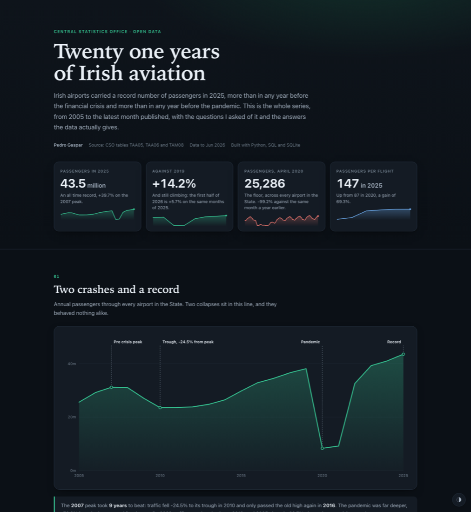

# Twenty one years of Irish aviation

Every passenger through every Irish airport since 2005, taken from Central Statistics
Office open data, loaded into SQLite and turned into one interactive page.

**[Open the dashboard](https://pedrogaspar-ds.github.io/irish-aviation/)**



The page has no external requests of any kind: no CDN, no fonts, no analytics, no chart
library. Every chart is SVG written by hand from the data. You can also just double click
`dashboard.html` with no internet at all.

## The questions

How has Irish air traffic actually moved over two decades, how did the two collapses in
the series differ, how seasonal is the traffic, where does Ireland fly, how much of it sits
in a handful of markets, and is anything changing in how that traffic is carried? These are
the questions a capacity planning or commercial team asks before it plans anything.

## What the data says

1. **The 2007 peak took nine years to beat. The pandemic took three.** Traffic fell 24.5%
   from the 2007 peak to its trough in 2010 and only passed the old high again in 2016. The
   pandemic was far deeper, 78.2% in a single year, and far shorter: 2023 was already above
   2019.
2. **2025 is an all time record**, 43.5 million passengers, 14.2% above 2019 and 39.7% above
   the pre crisis peak. January to June 2026 is 5.7% above the same months of 2025, so it is
   still climbing.
3. **April 2020 carried 25,286 passengers** through every airport in the State together,
   99.2% below the April before it. The busiest month on record, August 2025, is 181 times
   larger.
4. **The traffic is strongly seasonal and the winter gap is not closing.** August 2025
   carried 1.80 times the passengers of February 2025.
5. **The United Kingdom alone is 31.7% of country traffic**, more than the next three
   markets together, and the top ten markets carry 83.0% of it. Of the 38 markets with
   figures in both years, 37 grew since 2022. Türkiye grew fastest at +73.2%, while the
   eastern European routes that grew with migration have flattened: Lithuania is +1.2%.
   Russia carried passengers until 2022 and nothing since.
6. **Dublin is not the fastest growing airport.** Dublin is 11.4% above 2019, but Shannon is
   38.6% above it and Cork 33.9%. All six airports are now above their 2019 level, which the
   national total alone would hide. Dublin's share of national traffic peaked at 85.7% in
   2019 and is 83.6% in 2025.
7. **The aircraft are fuller or larger.** Passengers per flight went from 87 in 2020 to 147
   in 2025, a gain of 69.3%, because passengers grew far faster than flight movements.
   Freight followed its own path, up 49.8% across the same years, because most of it rides
   in the hold of passenger flights that were not flying.

Every one of those figures is produced by a query over the database. None is typed by hand.

## Data

Central Statistics Office Ireland, Aviation Statistics, through the public PxStat API:

| Table | What it gives | Coverage |
|---|---|---|
| TAA05 | annual passengers by airport | 2005 to 2025, 9 airports |
| TAM08 | monthly passengers by airport | Jan 2019 to Jun 2026 |
| TAA06 | passengers, freight and flights by market | 2020 to 2025, 59 markets |

Raw JSON-stat responses are stored exactly as received in `data/raw/`. Exact URLs, download
date and licence notes are in [data/SOURCES.md](data/SOURCES.md). Source site:
https://data.cso.ie

## How it is built

```
src/fetch.py            download raw JSON-stat from the CSO API into data/raw/
src/build_db.py         load into SQLite: 2 dimension tables, 3 fact tables
src/build_dashboard.py  query the database and write dashboard.html
src/analyse.py          the five original SQL questions, PNG charts and results.json
sql/                    one SQL file per question (q1 to q5)
```

Schema: `dim_airport`, `dim_market`, `fact_airport_year`, `fact_airport_month`,
`fact_market_year`, with primary keys, foreign keys and check constraints, so a bad
direction or flight type cannot enter the database in the first place.

## How to run

```
pip install -r requirements.txt
python3 src/fetch.py              # optional, the raw data is already in the repo
python3 src/build_db.py
python3 src/build_dashboard.py    # writes dashboard.html
python3 src/analyse.py            # optional, writes figs/*.png and data/results.json
```

Python 3.10 or newer. SQLite is in the standard library, and only `src/analyse.py` needs
matplotlib. To run a single query by hand:
`sqlite3 -header -column data/aviation.db < sql/q1_recovery_vs_2019.sql`

## Limitations

- 2026 covers January to June only.
- The public tables give passengers by destination **country**, not by route or airline, so
  concentration is measured at country level.
- Market detail starts in 2020, so no market comparison can reach back to 2019, and growth
  measured from 2020 or 2022 partly reflects recovery rather than new demand.
- Passengers per flight divides all passengers by all flight movements, including flights
  that carried only freight.
- Transit passengers are counted twice in the market table. The Canary Islands are a
  separate market from Spain in the CSO data. Figures are subject to revision.
- Cork was closed for runway works in October 2021, which is visible in its 2021 figures.
- This is descriptive analysis. It does not forecast, and it has no airline, seat or
  runway capacity data.

## Licence

Code: MIT. Data: CSO Ireland, reused under CC BY 4.0, see `data/SOURCES.md`.
